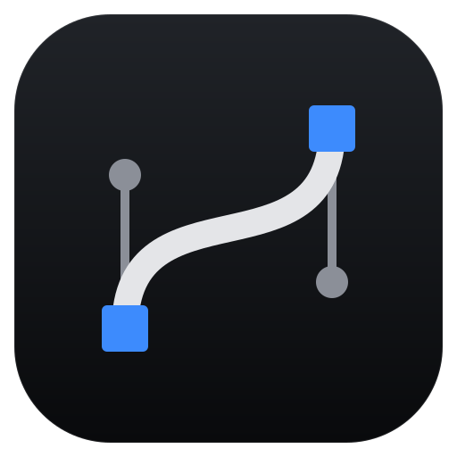
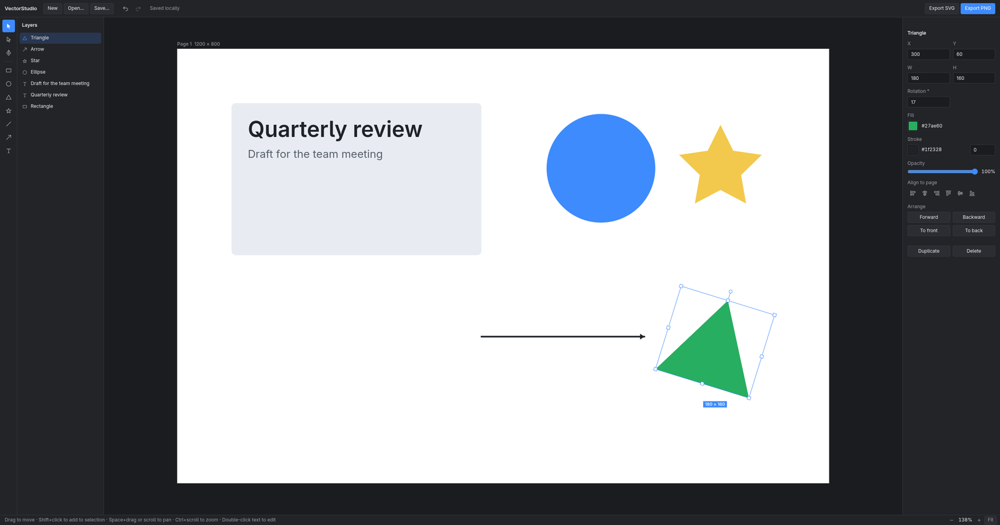

<p align="center">
  
</p>

<h1 align="center">VectorStudio</h1>



<p align="center">
  <strong>Desktop vector editor for Linux.</strong><br>
  Shapes, text and a Bézier pen on a single page, with layers, undo, SVG import, and clean SVG and PNG export.
</p>

<p align="center">
  
  
  
  
  
  
</p>

<p align="center">
  <a href="https://github.com/nodaysidle/no-vector-days/releases/download/v0.3.0/VectorStudio-0.3.0-x86_64.AppImage"><strong>Download Linux AppImage (v0.3.0)</strong></a>
  ·
  <a href="https://github.com/nodaysidle/no-vector-days/releases">All Releases</a>
</p>

<p align="center">
  <a href="#why-vectorstudio">Why VectorStudio</a> ·
  <a href="#features">Features</a> ·
  <a href="#shortcuts">Shortcuts</a> ·
  <a href="#install">Install</a> ·
  <a href="#development">Development</a> ·
  <a href="#privacy">Privacy</a>
</p>

---

## Why VectorStudio?

Most vector tools are either a browser tab tied to an account or a large suite. VectorStudio is a small editor that opens instantly, keeps your work on your machine, and exports files that look exactly like the page you drew.

It started as a WebKitGTK app that ran at 12 fps on a NUC 14 mini PC (Core Ultra 7 155H, Intel Arc iGPU). The shell was moved to Electron, which runs natively on Wayland: on the same machine the editor now holds the display's 120 Hz with 60 shapes on the page.

## Features

- **Shapes:** rectangle, ellipse, triangle, star, line, arrow and text. Pick a tool and click the page to place it.
- **Bézier pen:** click for corners, drag for curves, and edit any point or handle afterwards with the point tool.
- **Layers:** a list of every object; click to select, Shift+click or drag a box to select several, then move, duplicate or delete them together.
- **Properties:** position, size, rotation, corner radius, fill, stroke, opacity, alignment to the page, and stacking order. Every change can be undone.
- **Export:** SVG that keeps rotation, corner radius and text, and PNG at 2× of the page only, without selection handles.
- **Files:** autosave on your machine, plus Open, Save and Save as for `.json` design files. In the desktop app Save writes back to the file you opened.
- **SVG import:** Open also takes `.svg` files and turns them into editable layers: rectangles, circles and ellipses stay shapes; paths (including arcs and curves), polygons and lines become editable paths, with holes kept; text stays text; groups are flattened into separate layers; transforms, `<use>` and simple CSS classes are applied; and linear and radial gradient fills stay gradients (they export back to SVG as gradients too). An imported SVG opens as a new design, so Save never writes over the original file.
  Not carried over: patterns and gradient strokes (each becomes one colour), images, filters, masks, clipping paths and fonts other than the system UI font. Gradients can't be edited yet: picking a colour replaces one with a solid fill.
- **Page presets:** 1920 × 1080, 1200 × 800, 1080 × 1080, 1080 × 1920 and 800 × 1200, with any background colour.
- **Preview effects:** bloom, chromatic aberration, film grain and vignette, drawn with WebGL. They are only for the screen and never change exports.

## Shortcuts

| Keys | Action |
|---|---|
| `V` / `A` / `P` | Select / edit points / pen |
| `R` / `O` / `L` / `T` | Rectangle / ellipse / line / text |
| `Esc` | Back to select; finishes a pen path (so does `Enter`) |
| `Space` + drag, or scroll | Pan |
| `Ctrl` + scroll | Zoom at the cursor |
| `Ctrl+0` | Fit the page |
| `Ctrl+Z` / `Ctrl+Y` | Undo / redo |
| `Ctrl+D` / `Delete` | Duplicate / delete the selection |
| `Ctrl+S` / `Ctrl+Shift+S` / `Ctrl+O` | Save / save as / open a design or an SVG |

## Install

### AppImage

```bash
chmod +x VectorStudio-0.3.0-x86_64.AppImage
./VectorStudio-0.3.0-x86_64.AppImage
```

AppImages need FUSE 2 (`fuse2` on Arch). Without it, run with `APPIMAGE_EXTRACT_AND_RUN=1`.

### From source (Arch, using the system Electron)

```bash
git clone https://github.com/nodaysidle/no-vector-days.git
cd no-vector-days
sudo pacman -S electron43
./install.sh        # copies the app to ~/.local/share/vectorstudio, adds `vectorstudio` to ~/.local/bin and the app menu
```

## Development

```bash
npm install
npm start               # run with the Electron from npm
npm test                # engine tests: camera, scene, hit testing, history, Bézier, SVG export and import
npm run test:desktop    # Hyprland: native Wayland window, smoke test, real keystrokes via wtype
npm run dist            # build dist/VectorStudio-<version>-x86_64.AppImage
```

`vectorstudio --test` starts the app, runs an in-page smoke test and exits 0 or 1.
It waits for the window size to settle first (`waitForStableLayout` in `main.cjs`), because Hyprland resizes the window after it loads and early clicks land in the wrong place; keep that wait in any new desktop check. Run it ten times before calling a change stable: `for i in $(seq 10); do ./bin/vectorstudio --test 2>&1 | grep -o 'TEST [A-Z]*'; done`. To smoke-test a built AppImage on a machine without FUSE 2, use `APPIMAGE_EXTRACT_AND_RUN=1 ./dist/VectorStudio-<version>-x86_64.AppImage --test`.

| Path | What it is |
|---|---|
| `app/` | The editor: `index.html`, `style.css` and the engine in `app/src/` (no framework, no build step) |
| `main.cjs`, `preload.cjs` | Electron shell: serves `app/` over a private `app://` scheme, sandboxed, no navigation or popups; native Open/Save dialogs |
| `bin/vectorstudio`, `install.sh` | Launcher and installer for the system Electron |
| `test/` | Engine tests (Node) and Hyprland desktop tests (Python) |

## Privacy

No account, no network requests, no analytics. Your work is stored in the app's local storage and in the files you save.

## License

MIT. See [LICENSE](LICENSE).
